<div align="center">

# PULSE

**A premium gym and activity tracker for iPhone, Android, macOS and Windows, built from one Flutter codebase.**

Log strength workouts, track walks and runs with GPS, follow training programs and watch your progress grow, all with smooth animations and a dark-first design.


<br>

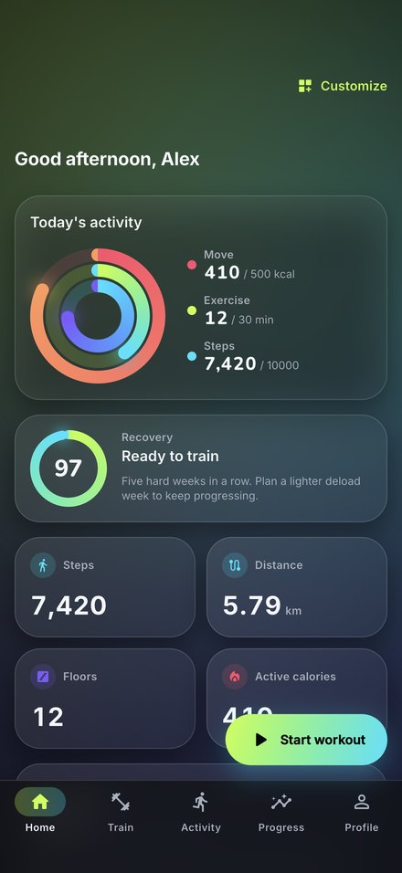&nbsp;
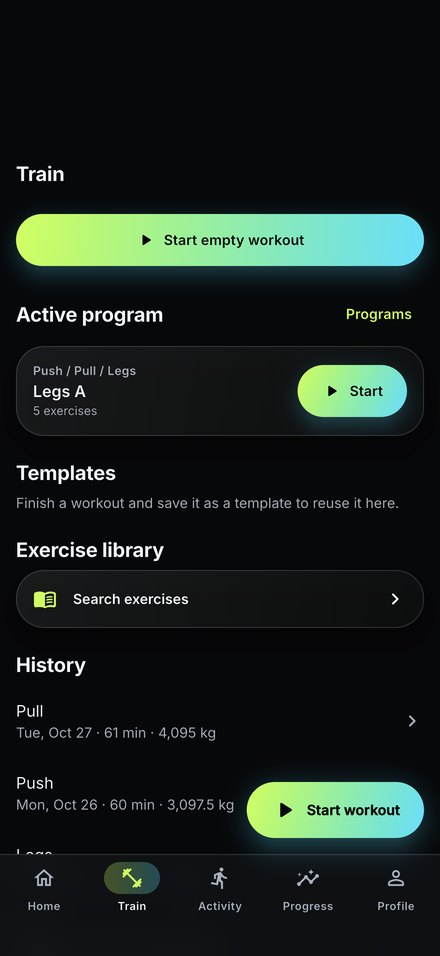&nbsp;
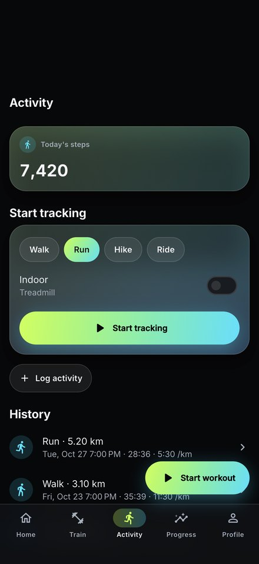&nbsp;
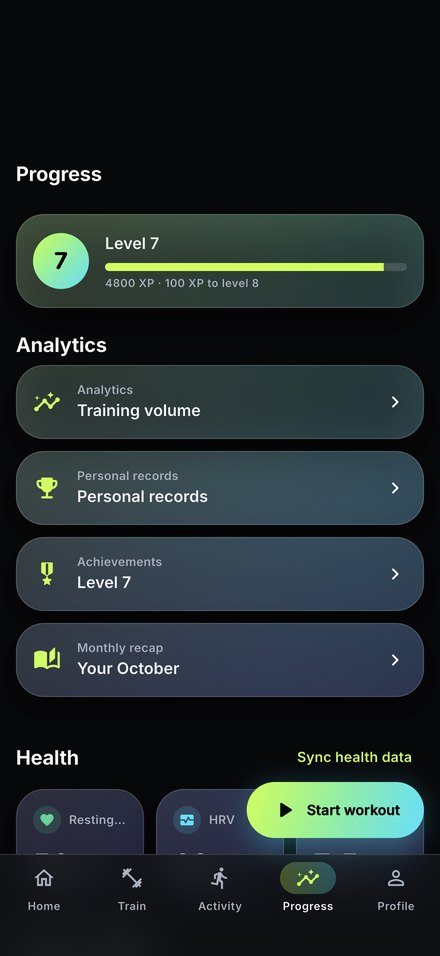

</div>

---

## Contents

- [Screenshots](#screenshots)
- [Features](#features)
- [Animations and design](#animations-and-design)
- [Platform support](#platform-support)
- [Tech stack](#tech-stack)
- [Getting started](#getting-started)
- [Building a release](#building-a-release)
- [Project layout](#project-layout)
- [Platform setup details](#platform-setup-details)
- [Testing, accessibility and performance](#testing-accessibility-and-performance)
- [Icons, splash and store screenshots](#icons-splash-and-store-screenshots)
- [Maps before release](#maps-before-release)
- [Your data and privacy](#your-data-and-privacy)
- [Adding a language](#adding-a-language)

---

## Screenshots

### With five weeks of workouts

These use the built-in demo data (`integration_test/demo_data.dart`), so you can see what the app looks like after regular use.

| Home | Train | Activity | Progress |
|:---:|:---:|:---:|:---:|
|  |  |  |  |
| Activity rings, recovery score, steps, distance, floors and calories | Active program, templates, exercise library and history | Today's steps, walk/run/hike/ride tracking and history | Level and XP, analytics, records, achievements and recap |

| Analytics | Run detail | Monthly recap |
|:---:|:---:|:---:|
| 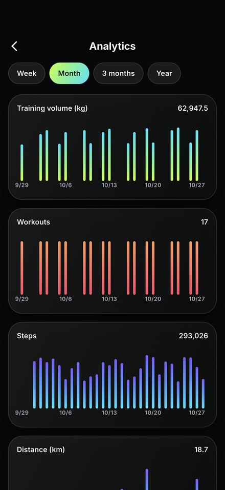 | 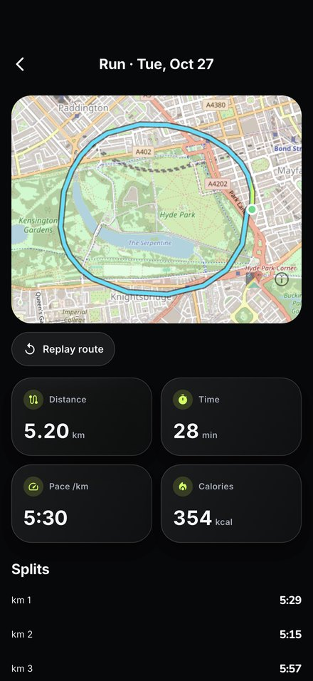 | 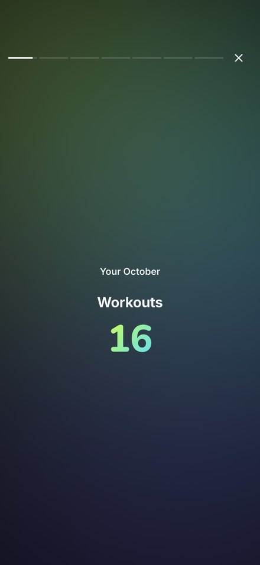 |
| Volume, workouts, steps and distance by week, month, 3 months or year | GPS route map with replay, stats and per-km splits | Story-style slides summing up your month |

### First launch

This is what a new user sees on a fresh install, before any workouts are logged.

| Splash | Home | Train |
|:---:|:---:|:---:|
| 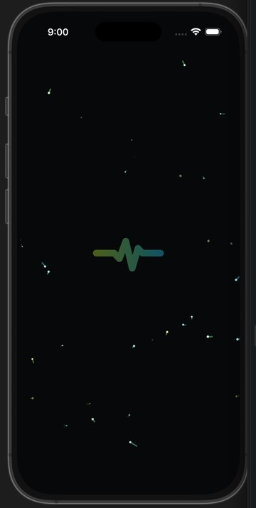 | 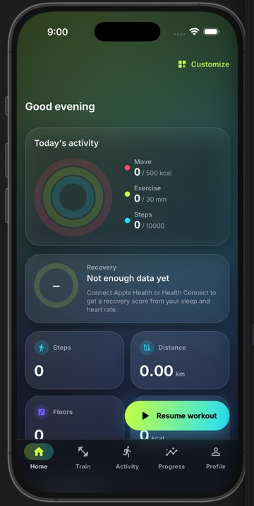 | 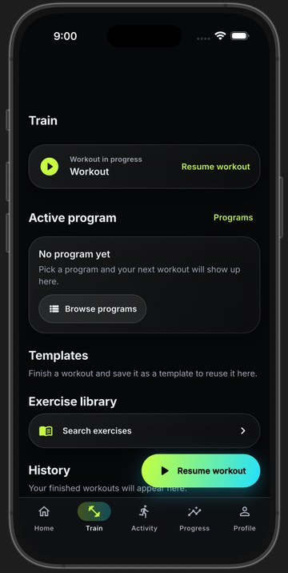 |
| Animated heartbeat logo with drifting particles | Empty rings and a prompt to connect health data | Prompt to pick a program |

| Activity | Progress | Profile |
|:---:|:---:|:---:|
| 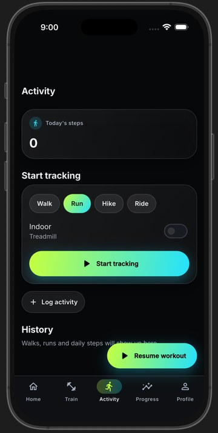 | 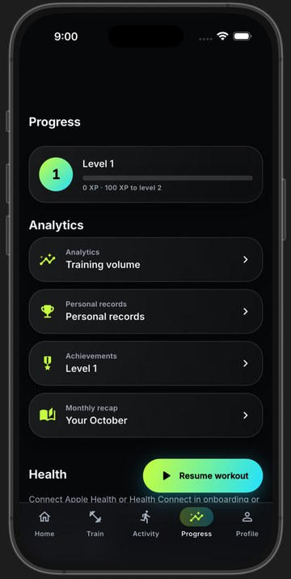 | 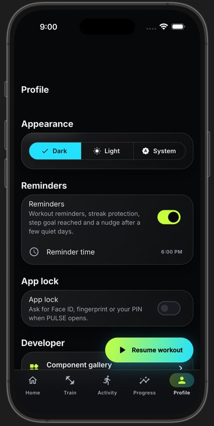 |
| Choose walk, run, hike or ride, outdoor or treadmill | Level 1, 0 XP, ready to start | Theme, reminders, app lock and developer gallery |

Full-resolution store screenshots for the App Store (iPhone 6.9" and iPad 13") and Google Play are in [`screenshots/`](screenshots/).

---

## Features

### Home dashboard
- Today's activity rings for Move (calories), Exercise (minutes) and Steps
- Steps, distance, floors climbed and active calories
- Recovery score with a "ready to train" verdict and coach tips
- Today's planned workout with one-tap start
- Weekly summary, current streak and recent personal records
- Customizable layout: reorder cards and show or hide them
- Pull to refresh

### Strength training
- Start an empty workout, a saved template or the next day of your program
- Log every set with weight, reps, RPE and set type (warm-up, working, drop set, failure)
- Supersets and circuits
- Your previous performance is filled in for you ("last time: 60 kg × 8")
- Automatic rest timer for each exercise, adjustable
- Plate calculator, and a 1-rep-max estimator using the Epley and Brzycki formulas
- Notes for each exercise and for the whole session
- Swipe a set to complete it, with a checkmark animation and haptics
- Workout summary with volume, duration, calories, records and a muscle heatmap
- The workout keeps running in the background, shown as a Live Activity on iPhone or an ongoing notification on Android

### Exercise library
- **226 exercises**, filterable by muscle group, equipment, difficulty and movement pattern
- Each exercise has form cues, common mistakes, the muscles it works and your personal history chart
- Search, favorites and your own custom exercises

### Programs and plans
- Five built-in programs: **Push / Pull / Legs**, **Upper / Lower**, **Full Body**, **5×5 Strength** and **Beginner 3-Day**
- Your next workout appears on Home and Train automatically
- Programs pin workouts to weekdays, which also drives your workout reminders
- The coach suggests a deload week after a long run of hard training weeks

### Walking, running and cardio
- All-day step counting on phones
- GPS tracking for outdoor walks, runs, hikes and rides, with a live map, pace, distance, elevation and splits
- Indoor and treadmill mode
- Background tracking with auto-pause
- Spoken audio cues every kilometre or mile
- Route replay animation after each session
- Manual entry for any cardio session

### Health and body
- Imports steps, distance, floors, active calories, heart rate, resting heart rate, HRV and sleep from **Apple Health** or **Health Connect**
- Writes finished workouts and walks/runs back to Apple Health or Health Connect
- Weight and body measurements with trend lines
- Water tracker with an animated filling glass
- Nutrition log with calorie and macro targets calculated from your profile (Mifflin-St Jeor plus your goal)
- Progress photos, encrypted on the device, with a side-by-side comparison slider

### Progress and motivation
- Analytics for training volume, workout count, steps, distance and weight, over a week, month, 3 months or year
- Personal records board
- Levels and XP: you earn XP for every workout and cardio session, and each level takes more XP than the last
- 12+ achievements, from your first workout up to 100 workouts, 30-day streaks, 25 records, 50 km covered and 10,000-step days
- Full-screen celebration with confetti when you unlock one
- Monthly recap told as animated story slides
- Shareable workout cards for social media

### Phone and desktop extras
- Home screen widgets with rings, steps, streak and next workout (iPhone and Android)
- Quick actions from the app icon: Start workout, Log water, Start walk
- Reminders on workout days, streak protection, step-goal alerts and a nudge after a few quiet days
- App lock with Face ID, fingerprint or PIN
- Dark, light and system themes
- kg/lb and km/mi units
- On desktop the window size and position are remembered between launches

---

## Animations and design

PULSE uses a custom design system (`lib/core/design_system`) with a dark-first look: a near-black background, frosted glass cards and an electric lime-to-cyan accent gradient.

| Animation | Where you see it |
|---|---|
| Activity rings with a glowing tip that overshoots and settles when a goal closes | Home |
| Odometer-style rolling numbers | Steps, calories, weight lifted |
| Hero transitions from card to full screen | Exercise library |
| Live heart-rate waveform and a heart that beats at your BPM | Workout screens |
| GPU fragment shaders: animated mesh gradient, shimmer, ripple | Home background, new PR badges, Start Workout button |
| Rest timer that counts down and morphs into "GO", with haptic ticks | During workouts |
| Parallax headers and cards that fade and scale as you scroll | Every tab |
| Confetti and a 3D medal flip | Achievement unlocks |
| Checkmark draw-on and swipe-to-complete with haptics | Logging sets |
| Cinematic splash with heartbeat logo and particles | App launch |

If you turn on **Reduce Motion** on your device, large movements are replaced with simple fades.

Every component and animation can be previewed in the **component gallery** (Profile › Developer › Component gallery, debug builds only).

---

## Platform support

| Feature | iPhone | Android | macOS | Windows |
|---|:---:|:---:|:---:|:---:|
| Workouts, library, programs, analytics, body, nutrition, photos | ✓ | ✓ | ✓ | ✓ |
| Step counting and GPS tracking | ✓ | ✓ | — | — |
| Apple Health / Health Connect | ✓ | ✓ | — | — |
| Home screen widget | ✓ | ✓ | — | — |
| Live workout on lock screen | Live Activity + Dynamic Island | Ongoing notification | — | — |
| Quick actions | ✓ | ✓ | — | — |
| Reminders | ✓ | ✓ | ✓ | ✓ |
| Recovery score and coach tips | ✓ | ✓ | from logged workouts | from logged workouts |
| Adaptive layout (sidebar, multi-column) | — | — | ✓ | ✓ |
| Window size and position remembered | — | — | ✓ | ✓ |

Laptops and desktops don't have step or GPS sensors, so those features are hidden on macOS and Windows rather than shown as broken buttons. You can still enter cardio sessions by hand there.

---

## Tech stack

| Area | Packages |
|---|---|
| UI and state | Flutter, Riverpod (with code generation), go_router (typed routes) |
| Models | freezed, json_serializable |
| Local database | drift (SQLite) |
| Health | health (Apple HealthKit and Health Connect) |
| Steps and location | pedometer, geolocator |
| Maps and charts | flutter_map (OpenStreetMap), fl_chart |
| Animation | flutter_animate, fragment shaders, rive, lottie |
| Platform features | flutter_local_notifications, home_widget, live_activities, quick_actions, local_auth, window_manager |
| Security | cryptography (AES-256-GCM), flutter_secure_storage |
| Other | flutter_tts, image_picker, share_plus, wakelock_plus, vibration, google_fonts, intl |

---

## Getting started

### Requirements

- Flutter 3.47+ (stable), Dart 3.13+
- **iPhone / macOS:** a Mac with Xcode 27+ and CocoaPods
- **Android:** Android SDK 36; accept the licenses with `flutter doctor --android-licenses`
- **Windows:** a Windows PC with Visual Studio 2022 and the **Desktop development with C++** workload

### First run

```bash
git clone https://github.com/Bujjinga/gym_app.git
cd gym_app
flutter pub get                      # also generates the localization code
dart run build_runner build          # Riverpod, go_router, freezed and drift code generation
flutter run -d <device>              # e.g. -d macos, -d windows, or a phone id
```

While developing, use `dart run build_runner watch` so generated code updates as you edit.

### Run on each platform

| Platform | Command |
|----------|---------|
| iPhone   | `flutter run -d <iphone-id>` (for the simulator, install an iOS runtime in Xcode › Settings › Components) |
| Android  | `flutter run -d <android-id>` |
| macOS    | `flutter run -d macos` |
| Windows  | `flutter run -d windows` (must run on a Windows machine) |

Run `flutter devices` to see the IDs of connected phones and simulators.

---

## Building a release

A release build is the fast, optimized version of the app meant for real users. The `flutter run` command makes a slower debug build.

```bash
flutter build apk --release        # Android APK
flutter build appbundle --release  # Android App Bundle for Google Play
flutter build ipa --release        # iPhone (Mac + Apple Developer account)
flutter build macos --release      # macOS
flutter build windows --release    # Windows (on a Windows PC)
```

The output files are in the `build/` folder. To publish a version on GitHub, open **Releases › Draft a new release**, create a tag that matches the `version` in `pubspec.yaml` (currently `v1.0.0`), and attach the built files.

Before publishing, switch the map tiles to a keyed provider (see [Maps before release](#maps-before-release)).

---

## Project layout

```
lib/
  app/                  app widget, typed go_router routes, adaptive shell, sidebar
  core/
    design_system/      tokens, theme, widgets, animations, shaders (one import: design_system.dart)
    database/           drift database, tables, DAOs and seed loading
    platform/           PlatformCapabilities, haptics, desktop window setup
    utils/              pure calculations: 1RM, plates, pace, HR zones, streaks, nutrition, units
  features/
    onboarding/  home/  workout/  exercises/  plans/  activity/  health/  body/
    nutrition/  progress/  achievements/  coach/  reminders/  security/  profile/
    settings/  gallery/
    (each with data/ domain/ application/ presentation/)
  l10n/                 ARB strings (app_en.arb); generated code in l10n/gen
shaders/                fragment shaders: mesh_gradient, shimmer, ripple
assets/
  seed/                 exercises.json (226 exercises), programs.json (5 programs)
  icon/                 app icon and splash artwork
screenshots/            store screenshots for App Store and Google Play
docs/images/            images used in this README
test/                   unit, widget, golden and accessibility tests
integration_test/       demo data, performance, screenshot and on-device checks
tool/                   icon generator and iOS widget-target script
```

---

## Platform setup details

### Base setup

- **macOS:** `com.apple.security.network.client` is in `macos/Runner/DebugProfile.entitlements` and `Release.entitlements` (for fonts and map tiles). The window opens at 1280×820, with a 900×600 minimum (`lib/core/platform/desktop_window.dart`).
- **Android:** `android/app/build.gradle.kts` sets `minSdk = 26` (needed by Health Connect) and `compileSdk = 37`, with core library desugaring enabled (needed by `flutter_local_notifications`). `AndroidManifest.xml` has `INTERNET`, `VIBRATE` and the app label `PULSE`.
- **iOS:** `CFBundleDisplayName` is `PULSE`.
- **Windows:** no changes needed; the window size comes from `window_manager` at runtime.

### Permissions and health

Already configured in the repo:
- **iOS** `Info.plist`: usage strings for Health (read and update), Motion, Location (when in use and always), Camera and Photos. `ios/Podfile` enables `PERMISSION_SENSORS` and `PERMISSION_NOTIFICATIONS` for permission_handler.
- **Android** `AndroidManifest.xml`: `ACTIVITY_RECOGNITION`, fine and coarse location, `POST_NOTIFICATIONS`, Health Connect read permissions (steps, distance, active calories, heart rate, resting HR, HRV, sleep, floors), the Health Connect rationale intent filter and package query. `MainActivity` extends `FlutterFragmentActivity`, which the health package requires.

**One manual step in Xcode:** open `ios/Runner.xcworkspace` › *Runner* target › *Signing & Capabilities* › **+ Capability › HealthKit**. Without it, the Health permission card shows "Not available on this device" instead of the system prompt.

On Android the Health card needs the Health Connect app, which is built in on Android 14 and later.

### Walks, runs and steps (phones only)

- **Android** `AndroidManifest.xml`: `ACCESS_BACKGROUND_LOCATION`, `FOREGROUND_SERVICE`, `FOREGROUND_SERVICE_LOCATION`, `WAKE_LOCK` and a `TTS_SERVICE` query for audio cues. Background tracking runs as a location foreground service with a persistent notification.
- **iOS** `Info.plist`: `UIBackgroundModes` = `location`, `processing`. In Xcode also tick *Signing & Capabilities › Background Modes › Location updates*.
- Step counting starts automatically once Motion & Fitness access is granted.

### Health sync

On phones, the last 7 days of steps, distance, floors, active calories, heart rate, resting HR, HRV and sleep are imported on launch and from Progress › Sync. Finished workouts and walks/runs are written back. Android also uses `health.WRITE_EXERCISE` and `READ_EXERCISE`. VO2 max isn't available in the version of the `health` package used.

### Progress photos

Photos are encrypted with AES-256-GCM. The key is kept in the iOS/macOS Keychain or the Android Keystore through `flutter_secure_storage`. On **macOS** the Keychain needs a signed build: in Xcode, set a *Team* for the Runner target (and add *Keychain Sharing* if asked). Otherwise the app shows "Secure storage isn't available" instead of saving photos. The macOS photo picker uses `com.apple.security.files.user-selected.read-only`, which is already added.

### Reminders and the recovery score

Reminders are off by default. Turn them on in **Profile › Reminders**, which asks for notification permission, and pick a time there. Workout reminders fire on the weekdays your active plan schedules workouts.

The recovery score combines sleep, HRV and resting heart rate from Apple Health or Health Connect with your recent training load. Without health data there's no score; the card asks you to connect health, and training-load tips still show. The coach is behind the `CoachService` interface (`lib/features/coach/domain/coach_service.dart`), so an AI coach can replace the rules later.

### Widgets and Live Activities

**Android** is fully configured: the widget receiver, layout and metadata, notification receivers and `RECEIVE_BOOT_COMPLETED`. Add the widget from the launcher's widget picker ("PULSE").

**iOS is also set up.** `ruby tool/add_ios_widget_target.rb` added the `PulseWidgets` extension target to `ios/Runner.xcodeproj`, with the App Group entitlement on both targets, and embedded it in the app. The script is safe to re-run. When you sign for a real device, open *Signing & Capabilities* once so Xcode registers the App Group with your team. It has been checked on the iPhone 17 Pro Max simulator.

<details><summary>Equivalent manual Xcode steps, for reference</summary>

1. `open ios/Runner.xcworkspace`
2. **File › New › Target… › Widget Extension**. Product name `PulseWidgets`. Untick *Include Configuration App Intent*, tick *Include Live Activity*, then click **Finish**. If asked to activate the scheme, choose **Cancel**.
3. Delete every Swift file Xcode generated in the new `PulseWidgets` group, then drag in `ios/PulseWidgets/PulseWidgets.swift` (target membership: **PulseWidgets** only).
4. Set the extension's **Minimum Deployments** to iOS 17.0.
5. Select the **Runner** target › *Signing & Capabilities* › **+ Capability › App Groups** › add `group.com.example.gymApp.pulse`. Do the same for the **PulseWidgets** target with the same group. If you change your bundle id, change the group in `lib/core/platform/platform_capabilities.dart` (`pulseAppGroup`) and in `PulseWidgets.swift` too.
6. In the **PulseWidgets** target's *Info* tab, add `NSSupportsLiveActivities` = `YES`. The Runner already has it.
7. In the **Runner** target › *Build Phases*, make sure **Embed Foundation Extensions** is **above** *Run Script / Thin Binary*. If it's below, drag it up, or the build fails with a cycle error.
8. Run on a device or simulator, then long-press the home screen › **+** › PULSE. Start a workout and lock the phone to see the Live Activity.

Until this is done, the app still runs; widget and Live Activity calls just do nothing.

</details>

### Desktop window

On macOS and Windows the window frame is saved to `window_state.json` in the app support folder and restored on launch. If that monitor is no longer connected, the window opens centered.

---

## Testing, accessibility and performance

```bash
flutter test                                   # unit + widget + golden + accessibility
flutter test --update-goldens test/core        # regenerate goldens after intended UI changes
```

Golden images are rendered with the test font and can differ slightly between operating systems, so regenerate them on the machine or CI image that runs them.

**Accessibility.** `test/app/accessibility_test.dart` opens every tab with Reduce Motion on, in dark and light mode, at 200% text size. It checks tap-target sizes for Android and iOS, labels on everything tappable and WCAG text contrast. It also checks that every screen settles, so no animation keeps running with Reduce Motion on. Light mode uses the `accentText` color token (a deeper green) for accent text, because lime on white fails contrast.

**Performance.** Run in profile mode, ideally on a real phone:

```bash
flutter drive --profile --driver=test_driver/perf_driver.dart --target=integration_test/perf_test.dart -d <device>
```

Frame-timing summaries are written to `build/{home,exercise_library,analytics}.timeline_summary.json`. On an M-series Mac the 99th-percentile frame build time is under 2.3 ms on every screen. Raster (GPU) time averages 6.3 ms on Home and 2.4 ms in the exercise library. Glass cards share one backdrop blur through `BackdropGroup`, which cut Home's raster time by about 40%.

**On-device checks.** `flutter test integration_test/device_checks_test.dart -d <device>` runs the accessibility audit on five weeks of demo data with real fonts, plus the Live Activity check on iOS.

---

## Icons, splash and store screenshots

**App icon and splash.** `tool/make_icon.swift` draws the heartbeat mark into `assets/icon/`. To regenerate everything:

```bash
swift tool/make_icon.swift
dart run flutter_launcher_icons        # Android (adaptive), iOS, macOS, Windows
dart run flutter_native_splash:create  # iOS + Android launch screen
```

macOS and Windows have no native splash screen; the window opens straight onto the dark background. The app is named **PULSE** on every platform.

**Store screenshots.** These use demo data from `integration_test/demo_data.dart`, which writes to an in-memory database and never touches your real data.

```bash
xcrun simctl boot "iPhone 17 Pro Max"
xcrun simctl status_bar "iPhone 17 Pro Max" override --time 9:41 --batteryState charged --batteryLevel 100
flutter drive --driver=test_driver/screenshot_driver.dart --target=integration_test/screenshots_test.dart -d "iPhone 17 Pro Max"
```

Seven screens are saved to `screenshots/<width>x<height>/`. Already captured:

| Device | Size | Store |
|---|---|---|
| iPhone 17 Pro Max | 1320×2868 | App Store 6.9" |
| iPad Pro 13" | 2064×2752 | App Store iPad |
| Pixel 8 Pro | 1344×2992 | Google Play |

For Android, set the demo status bar first: `adb shell am broadcast -a com.android.systemui.demo -e command clock -e hhmm 0941`.

---

## Maps before release

Route maps use OpenStreetMap's public tile server by default. That's fine for development, but [its policy](https://operations.osmfoundation.org/policies/tiles/) doesn't allow it in a published app. Sign up with a tile provider (for example Stadia Maps, MapTiler or Thunderforest; most have a free tier, and a dark style suits PULSE), then build with:

```bash
flutter build ipa \
  --dart-define=MAP_TILE_URL="https://tiles.stadiamaps.com/tiles/alidade_smooth_dark/{z}/{x}/{y}@2x.png?api_key=YOUR_KEY" \
  --dart-define=MAP_TILE_ATTRIBUTION="© Stadia Maps © OpenMapTiles © OpenStreetMap contributors"
```

Use the attribution text your provider requires; the map shows it in its corner.

---

## Your data and privacy

PULSE keeps everything in a local SQLite database on each device. There are no accounts and no server. Nothing leaves the device except what you choose to share with Apple Health or Health Connect, or share as a workout card. Progress photos are encrypted, and the app can be locked with Face ID, fingerprint or PIN. Uninstalling the app deletes all its data.

---

## Adding a language

Copy `lib/l10n/app_en.arb` to `app_<locale>.arb` (for example `app_bn.arb` for Bangla), translate the values and run `flutter pub get`. The new language is picked up automatically through `AppLocalizations.supportedLocales`.
